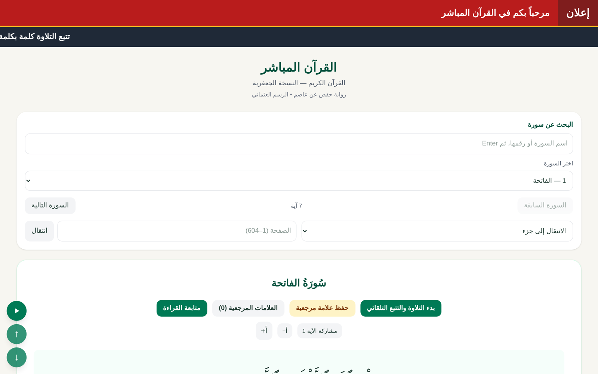
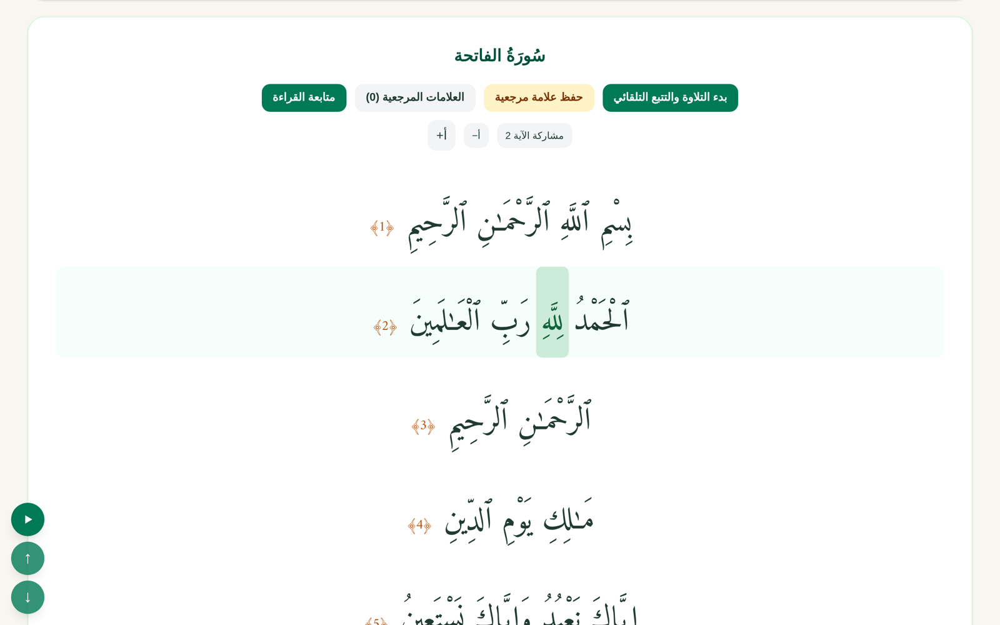
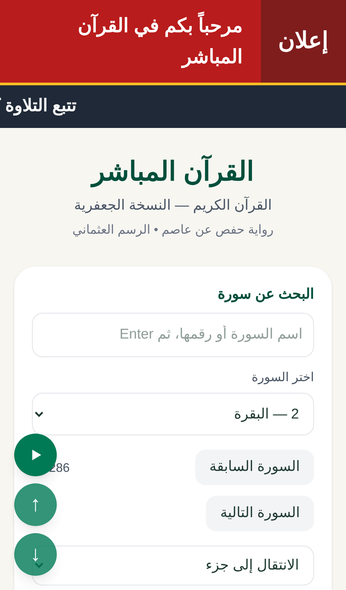
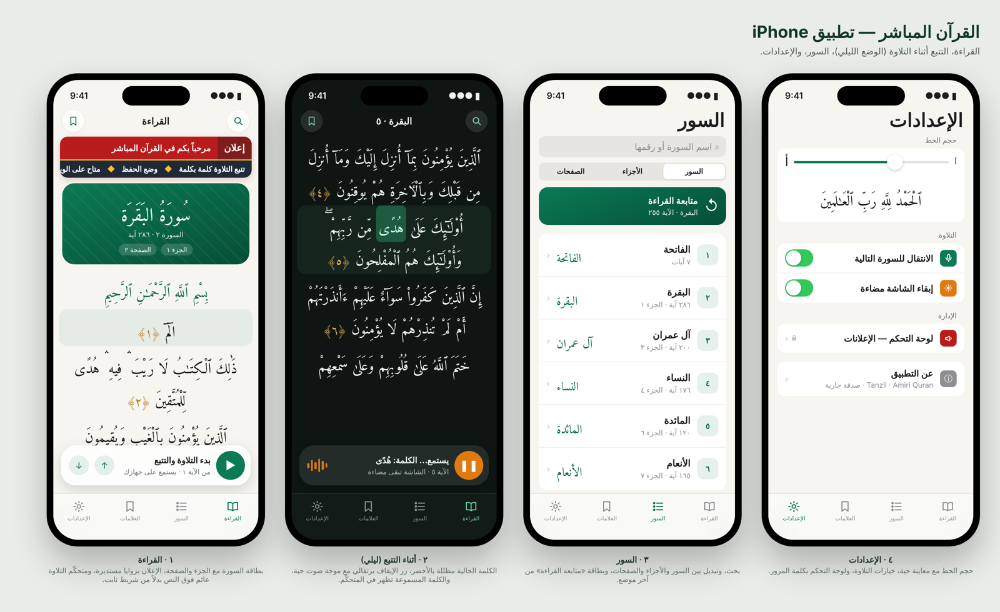

# القرآن المباشر · Quran Live

**اقرأ القرآن الكريم، ودَع التطبيق يتابع تلاوتك كلمةً بكلمة.** 
**Read the Quran while the app follows your recitation, word by word.**

[quran.ialmosawi.com](https://quran.ialmosawi.com)

---

## نبذة

القرآن المباشر قارئ للقرآن الكريم باللغة العربية، يعرض النص كاملاً بالرسم العثماني برواية حفص عن عاصم. عند بدء التلاوة يستمع إلى صوتك ويظلّل الكلمة التي تقرؤها، وينتقل تلقائياً إلى السورة التالية عند إكمال السورة. متاح على الويب، وتطبيق iPhone قيد التطوير.

هذا العمل صدقة جارية.

## About

Quran Live is an Arabic, right-to-left Quran reader with the full Uthmani text (Hafs). Start reciting and it listens, highlights the word you are reading, and continues into the next surah when you finish one. It runs on the web, and an iPhone app is in development.

It is a reading and practice aid; it does not judge tajweed.

## Screenshots

**Website**

**iPhone app**

## Features · المزايا

| | Website | iPhone app |
| --- | :---: | :---: |
| All 114 surahs, Uthmani script, Amiri Quran font | ✓ | ✓ (offline) |
| Word-by-word recitation tracking | ✓ | ✓ |
| Continues into the next surah | ✓ | ✓ |
| Pause and resume (for passing reading to another person) | ✓ | ✓ |
| Memorization mode: hide the text, flag missed or wrong words | ✓ | — |
| Track a recorded recitation from an audio file | ✓ | — |
| Search by surah name or number | ✓ | ✓ |
| Juz and Madani page navigation | ✓ | ✓ |
| Bookmarks and saved reading position | ✓ | ✓ |
| Font size, dark mode | ✓ | ✓ |
| Shareable links to an ayah | ✓ | ✓ |
| Announcement banner, updated live by the site admin | ✓ | ✓ |
| Works on phones, tablets, desktops and TVs | ✓ | iPhone, iPad |

The four obligatory sajdah positions in the Ja'fari school are marked in the text.

## Privacy · الخصوصية

- **Website:** recitation is recognized in your browser, on your device. The page downloads a recognition model the first time; your microphone audio is not sent to the server. If the in-browser engine cannot start, a slower fallback sends short audio clips to the server for recognition; they are processed in memory and not saved.
- **iPhone app:** recitation is recognized on the iPhone with Apple's speech recognition (on iOS 26, Apple's on-device live engine; its Arabic model is downloaded once).
- No accounts, no tracking, no ads. Bookmarks, reading position and settings stay on your device. The only data fetched from the server is the Quran text (website) and the announcement banner.

## Credits and licenses · المصادر

- **Quran text and juz/page data:** [Tanzil.net](https://tanzil.net), reproduced verbatim with attribution.
- **In-browser recitation tracking:** [Tilawa](https://tilawa.dev) (`@tilawa/core`, MIT; model weights CC BY 4.0).
- **Quran font:** [Amiri Quran](https://github.com/aliftype/amiri), SIL Open Font License 1.1.
- **Server fallback recognizer:** Tilawi (MIT), with a model derived from NVIDIA's Arabic FastConformer (CC BY 4.0).

## App Store links · روابط التطبيق

- [Privacy Policy · سياسة الخصوصية](PRIVACY.md)
- [Support · الدعم](SUPPORT.md)
- [Marketing / About · عن التطبيق](ABOUT.md)

## Source code

The source code is kept in a private repository. This repository holds the project's public description and screenshots.
